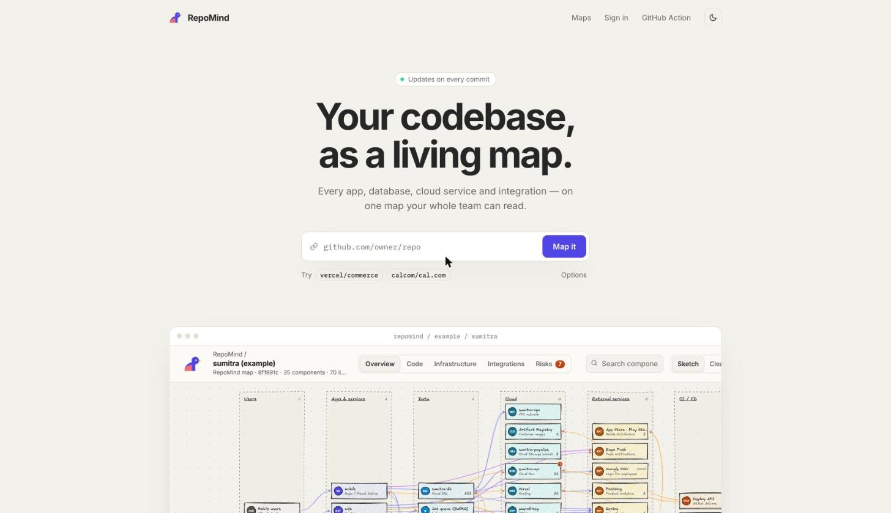
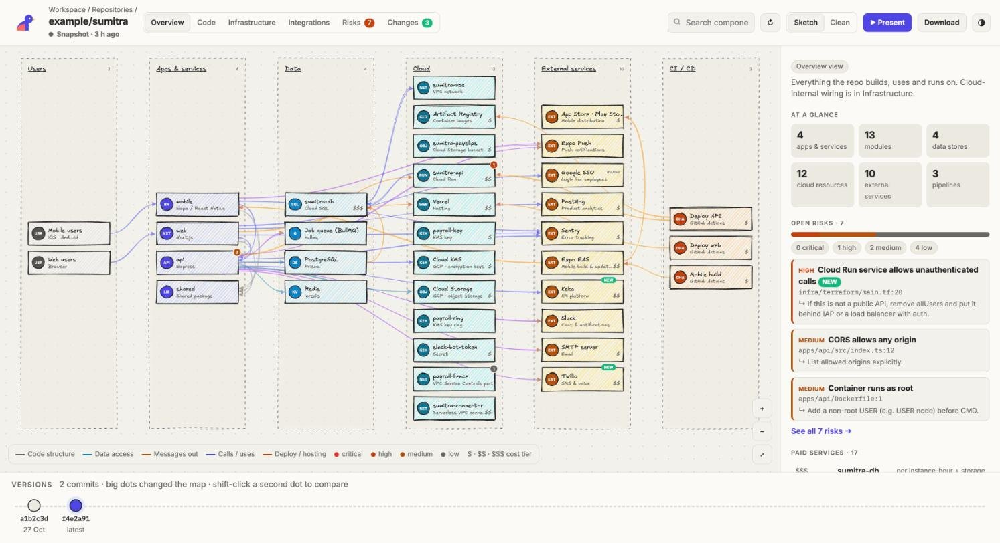
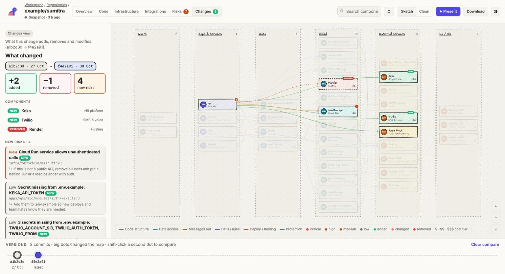
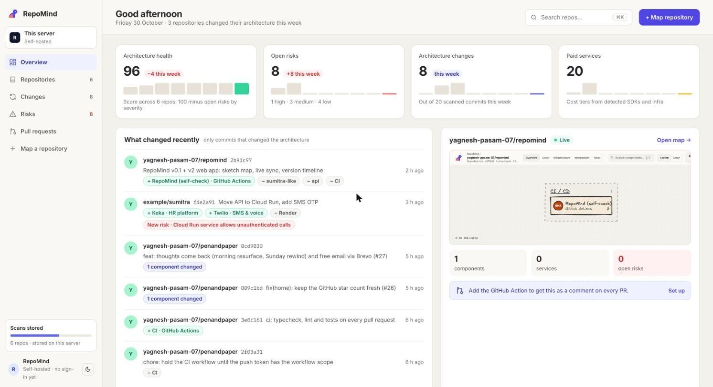
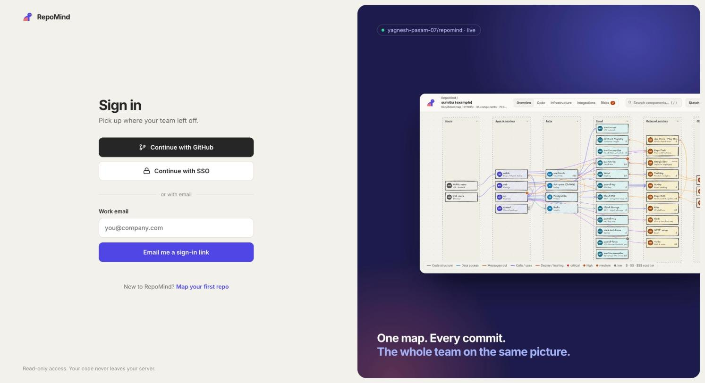
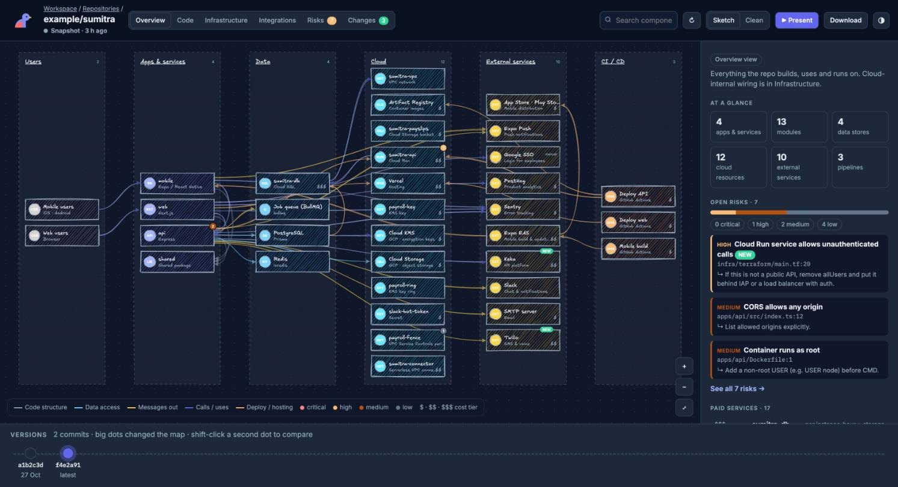
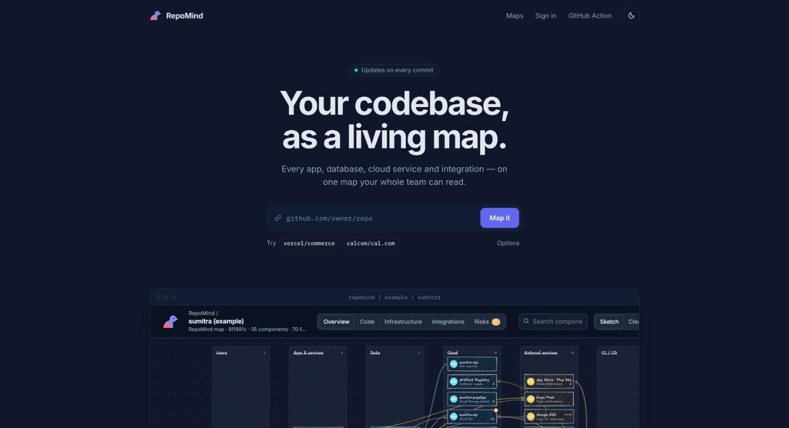

<p align="center">
  
</p>

<h1 align="center">RepoMind</h1>

<p align="center"><b>Your codebase, as a living map.</b><br/>
A live map of your code, infrastructure and integrations, with a PR comment that shows what each change does to it.</p>

<p align="center">
  <a href="https://repomind-pi.vercel.app"><b>Live demo</b></a> ·
  <a href="https://repomind-pi.vercel.app/map">Example map</a> ·
  <a href="#quick-start">Quick start</a> ·
  <a href="PRODUCT.md">Product spec</a> ·
  <a href="CONTRIBUTING.md">Contributing</a>
</p>

<p align="center">
  <a href="LICENSE"></a>
  
  
</p>

<p align="center">
  
</p>

RepoMind reads a repository (no cloud credentials, no code leaves your CI) and draws one map of:

- **Apps and modules**: Next.js, Expo/React Native, Express, NestJS and more, split into feature modules (leave, payroll, auth…) with their API routes
- **Data**: Postgres/MySQL/Mongo/Redis/queues, including Prisma models
- **Cloud (GCP)**: Cloud Run, Cloud SQL, Storage, KMS, VPC, VPC Service Controls, Secret Manager, Pub/Sub… from Terraform and deploy scripts
- **External services**: SMS (Twilio, MSG91), email (SMTP, SendGrid, Resend), Slack, Keka, payments, AI APIs, analytics
- **CI/CD**: GitHub Actions and Cloud Build, and what each pipeline deploys where

Then on every pull request it posts **one comment** with:

- ➕ ➖ ✏️ components added, removed or changed
- ⚠️ **new security risks**: committed secrets, public buckets, unauthenticated Cloud Run, open SQL, root containers, CORS `*`…
- 💸 **cost impact**: "adds Twilio · $$ · per SMS"
- a small diagram of only what changed

Every box on the map has **evidence** (file and line), so you can check why it is there.

## Screenshots

| | |
| --- | --- |
|  **Live map** — every app, data store, cloud resource and service, with risks and cost |  **Compare versions** — what a change added, removed and put at risk |
|  **Workspace** — health, risks and architecture changes across every repo |  **Sign in** |
|  **Dark mode** |  **Website, dark** |

---

## Quick start

```bash
npm install
npm run build

# Map any repo → .repomind/graph.json + .repomind/map.html
node bin/repomind.js map /path/to/your/repo

# Open the map
open .repomind/map.html
```

Try it on the built-in example (a Sumitra-like monorepo):

```bash
npm run demo        # writes examples/output/{graph.json,map.html,map-with-changes.html,pr-comment.md}
npm test            # 13 checks: the example repo plus v2 server pieces
```

## Commands

| Command | What it does |
| --- | --- |
| `repomind scan [dir] -o graph.json` | Scan and write the graph |
| `repomind view graph.json -o map.html [--base base.json]` | Build the interactive map; with `--base`, highlight changes |
| `repomind diff base.json head.json -o comment.md [--fail-on critical]` | PR comment markdown; exit code 2 if the PR adds risks at or above `--fail-on` |
| `repomind map [dir]` | `scan` + `view` in one go |
| `repomind serve [--port 4242] [--data .repomind-data] [--poll 5]` | v2 web app: paste a GitHub URL, get a live sketch map with version history |

## The map

One self-contained HTML file. Open it locally, attach it to a CI run, or host it.

| View | Shows |
| --- | --- |
| **Overview** | Users → apps → data → cloud → external services → CI/CD |
| **Code** | Each app's feature modules and exactly what each module touches |
| **Infrastructure** | Where things run, how they deploy, what protects them (VPC-SC, KMS) |
| **Integrations** | Every third-party service and who calls it |
| **Risks** | Findings placed on the components they affect |
| **Changes** | Added / removed / changed, when built with `--base` |

Click a box for its details, risks, connections, routes, models and evidence. Press `/` to search, `1`–`6` to switch views, `F` to fit, `T` for theme, and **`P` to present**: a step-by-step walkthrough you can use in a review meeting. Export to PNG or SVG for slides.

## Web app (v2)

Try the public showcase at **[repomind-pi.vercel.app](https://repomind-pi.vercel.app)**. It shows the website and an example map; mapping your own repos runs on your server (below), so your code never leaves it.

```bash
npm install && npm run build
GITHUB_TOKEN=$(gh auth token) node bin/repomind.js serve   # → http://127.0.0.1:4242
```

Paste `github.com/owner/repo`, watch the map weave itself, and get a hand-drawn map. Screens follow the [v2 designs](docs/design/README.md):

| Page | What it is |
| --- | --- |
| `/` | Website: paste a repo, live example map |
| `/login` | Sign in |
| `/app` | Workspace overview: health, risks, changes, all repos |
| `/r/owner/repo` | Live map with version timeline, compare, download & share |

- **Live:** tick *Keep it live* to poll the branch every 5 minutes, or add the webhook shown under **Download → Keep it live** (`/api/webhook/github`, HMAC-signed) for instant updates.
- **Versions:** each commit is a dot on the timeline at the bottom; big dots changed the map. Click a dot to load it, shift-click a second one to compare.
- **Sketch / Clean:** toggle at the top (or press `S`); same commit always draws the same wobble.
- **Download:** PNG, SVG, an offline HTML map, or the graph JSON. Share `/r/owner/repo` (always latest) or add `?sha=` to pin.
- **Private repos:** add a token on the landing page; it stays in `.repomind-data/` on the server (mode 0600) and is never returned by the API.

Without a `GITHUB_TOKEN` the GitHub API allows 60 requests/hour, which is enough for a few maps.

## GitHub Action

Add `.github/workflows/repomind.yml` to the repo you want to map:

```yaml
name: RepoMind
on:
  pull_request:
  push:
    branches: [main]
permissions:
  contents: read
  pull-requests: write
jobs:
  map:
    runs-on: ubuntu-latest
    steps:
      - uses: actions/checkout@v4
        with:
          fetch-depth: 0
      - uses: YOUR-ORG/repomind@main
        with:
          fail-on: critical   # critical | high | medium | low | none
```

Each PR gets one comment, updated in place on every push, and the map is uploaded as the `repomind-map` artifact.

## Corrections: `.repomind.yml`

Some things live outside the repo (resources built in the GCP console, SSO, a vendor). Add them by hand, rename, describe or hide:

```yaml
ignore: [examples, scripts]          # folders to skip
rename:
  "app:apps-api": "Sumitra API"
describe:
  "gcp:run:sumitra-api": "Production API in tl-sumitra-prod (asia-south1)."
hide: ["mod:apps-web/*"]             # globs on node ids
nodes:
  - { id: "ext:google-sso", label: "Google SSO", kind: external, layer: external, tech: "Employee login" }
edges:
  - { from: "app:apps-web", to: "ext:google-sso", kind: calls, label: "login" }
```

Hand-added nodes are marked **manual** on the map.

## How it works

```
repo files ─► detectors (rules, no AI) ─► overrides ─► security & cost rules ─► graph.json
                                                                              ├─► map.html
                                         base graph.json ─► diff ─────────────┴─► PR comment
```

- **Rules before AI.** Detection is deterministic: the same commit gives the same graph, so diffs only show real changes.
- **Evidence on everything.** Nodes, edges and findings carry `file:line`.
- **Secrets are never stored.** Findings record the rule, file and line only.

| Detector | Reads |
| --- | --- |
| `workspace` | every `package.json` → apps, services, libraries, frameworks, internal deps |
| `modules` | `src/modules/*`, `src/features/*`, `app/*`… → feature modules, routes, module→module imports |
| `integrations` | SDK imports, `process.env.*`, `.env.example`, URLs → external services, GCP SDKs, data stores, Prisma |
| `docker` | `Dockerfile`, `docker-compose.yml` |
| `ci` | `.github/workflows/*`, `cloudbuild.yaml`, `vercel.json`, `eas.json`, `render.yaml`, `firebase.json` |
| `terraform` | `google_*` resources and the references between them; VPC-SC restricted services |

Add a provider in `src/catalog.ts` (one line), or a rule in `src/rules/security.ts`.

## Roadmap

- **v0.2** tune on Sumitra to 95% precision
- **v0.3** live GCP sync (Cloud Asset Inventory) and "drift" between repo and cloud
- **v0.4** flows view: trace one user action across services
- **v1.0** Python and AWS detectors as plugins

v2 (web app, sketch style, live versions) is built; see [PRODUCT.md](PRODUCT.md).

## Made by


**Yagnesh Pasam**<br/>
[LinkedIn](https://www.linkedin.com/in/yagneshpasam/) · [yagneshpasam0@gmail.com](mailto:yagneshpasam0@gmail.com)

<br clear="left"/>

## License

MIT
