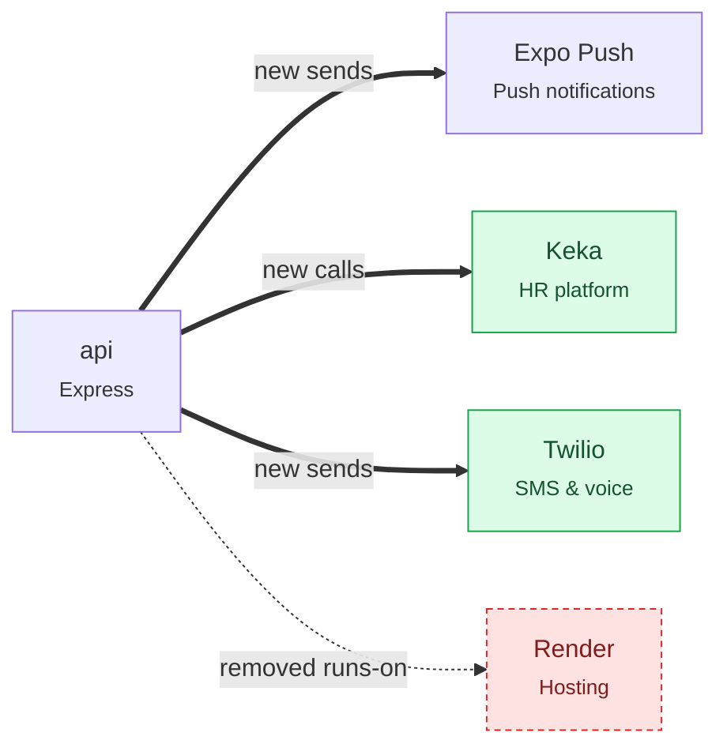

<!-- repomind:pr-comment -->
### 🧠 RepoMind — architecture impact
**+2 components · −1 removed · 4 new risks (1 high+) · cost ↑**

#### ⚠️ New risks
- 🟠 **HIGH** Cloud Run service allows unauthenticated calls — `infra/terraform/main.tf:20` ↳ If this is not a public API, remove allUsers and put it behind IAP or a load balancer with auth.
- ⚪ **LOW** Secret missing from .env.example: KEKA_API_TOKEN — `apps/api/src/modules/auth/keka.ts:3` ↳ Add them to .env.example so new deploys and teammates know they are needed.
- ⚪ **LOW** 3 secrets missing from .env.example: TWILIO_ACCOUNT_SID, TWILIO_AUTH_TOKEN, TWILIO_FROM — `apps/api/src/modules/auth/otp.ts:2` ↳ Add them to .env.example so new deploys and teammates know they are needed.
- ⚪ **LOW** Secret missing from .env.example: EXPO_ACCESS_TOKEN — `apps/api/src/modules/notifications/push.ts:2` ↳ Add them to .env.example so new deploys and teammates know they are needed.

#### ➕ Added
| Component | Layer | Tech | Cost | Evidence |
| --- | --- | --- | --- | --- |
| Keka | External service | HR platform | $$ per employee (subscription) | `apps/api/src/modules/auth/keka.ts:3` |
| Twilio | External service | SMS & voice | $$ per SMS / call | `apps/api/src/modules/auth/otp.ts:1` |

#### ➖ Removed
| Component | Layer | Tech | Cost | Evidence |
| --- | --- | --- | --- | --- |
| Render | Cloud | Hosting | $$ per instance | `apps/api/render.yaml` |

#### 💸 Cost impact
- ↑ Adds **Keka** · $$ · per employee (subscription)
- ↑ Adds **Twilio** · $$ · per SMS / call
- ↓ Removes **Render** · $$ · per instance

<b>What changed on the map</b>

Repo now: 35 components · 70 links · open risks 🔴0 🟠1 🟡2 ⚪4
